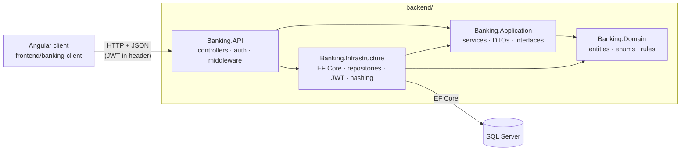

# Banking Operations System

A small, complete **bank back-office application** built with **ASP.NET Core 10** and **Angular 22**.
Bank employees sign in, manage customers and bank accounts, process deposits and withdrawals,
transfer money between accounts and review the transaction history.

The goal of the project is clarity: a layered architecture that is easy to read, explain and extend,
with the important financial rules enforced in one place and covered by unit tests.

> ⚠️ Educational/portfolio project. It does not connect to any real bank or payment system.

---

## Features

| Area | What you can do |
|------|-----------------|
| **Authentication** | Sign in with username + password, receive a JWT (60 min). |
| **Authorization** | Two roles: **Admin** and **Employee**. Only Admins can open bank accounts. |
| **Dashboard** | Totals (customers, accounts, money held, transactions today) + latest transactions. |
| **Customers** | List, search and create customers (unique email and national ID). |
| **Bank accounts** | List/filter accounts, open Checking or Savings accounts with an optional initial deposit (Admin). |
| **Deposits & withdrawals** | Cash in / cash out on an account; every operation is recorded. |
| **Transfers** | Move money between two accounts atomically, with a shared reference number. |
| **Transaction history** | Per-account history and a global "latest transactions" view. |

### Business rules

- Amounts must be **> 0**, **≤ 1,000,000** per operation and have **at most 2 decimal places**.
- A balance can **never become negative** — withdrawals/transfers above the balance are rejected
  (checked in the domain model *and* by a database check constraint).
- A transfer **cannot exceed the source balance** and **cannot target the same account**.
- A transfer runs in an **explicit database transaction**: both balance updates and both history
  rows are saved together, or nothing is saved.
- **Optimistic concurrency** on `Balance`: if two requests change the same account at the same time,
  the second one is rejected (HTTP 409) instead of silently overwriting the first.
- All endpoints except login require a valid JWT; opening accounts requires the **Admin** role.

---

## Technology stack

| Layer | Technology |
|-------|------------|
| Backend | .NET 10 (LTS), ASP.NET Core Web API, C# |
| Data access | Entity Framework Core 10, SQL Server (LocalDB for development) |
| Security | JWT Bearer authentication, role-based authorization, PBKDF2 password hashing (ASP.NET Core Identity's `PasswordHasher`) |
| API docs | Swagger UI (Swashbuckle) |
| Tests | xUnit + EF Core SQLite in-memory provider |
| Frontend | Angular 22 (standalone components, signals, reactive forms, functional guard/interceptor), plain CSS |

No other libraries are used (no MediatR, no AutoMapper, no UI component library).

---

## Architecture



Arrows show **project references** (who depends on whom). The core rule: **Domain depends on nothing**,
Application depends only on Domain, and Infrastructure *implements* the interfaces that Application defines.
The API project wires everything together in `Program.cs`.

| Project | Responsibility | Key files |
|---------|----------------|-----------|
| `Banking.Domain` | Entities and the rules that protect them. `BankAccount.Deposit/Withdraw` are the only way to change a balance. | `Entities/BankAccount.cs` |
| `Banking.Application` | Use cases (business logic) as plain service classes; request/response DTOs; small, entity-specific repository interfaces. | `Services/TransactionService.cs` |
| `Banking.Infrastructure` | EF Core `DbContext`, migrations, repository implementations, unit of work (DB transactions), JWT creation, password hashing, dev seed data. | `Data/BankingDbContext.cs`, `Data/UnitOfWork.cs` |
| `Banking.API` | Thin controllers, JWT/CORS/Swagger setup, global exception → ProblemDetails middleware. | `Program.cs`, `Middleware/ExceptionHandlingMiddleware.cs` |
| `Banking.Tests` | Unit tests for the domain rules and service-level tests against a real (in-memory SQLite) database. | `Services/TransactionServiceTests.cs` |

### Request flow example — `POST /api/transfers`

1. **Angular** `TransferComponent` calls `BankingApiService.transfer()`; `authInterceptor` adds the JWT.
2. **ASP.NET Core** validates the token, and `[ApiController]` validates the `TransferRequest` DTO (data annotations → 400 on failure).
3. `TransactionsController.Transfer` passes the DTO and the current username to `TransactionService.TransferAsync`.
4. The service loads both accounts via `IBankAccountRepository` and calls `IUnitOfWork.ExecuteInTransactionAsync`, inside which
   `from.Withdraw(amount)` and `to.Deposit(amount)` apply the domain rules and two `Transaction` rows are recorded.
5. `UnitOfWork` saves and commits; any exception rolls everything back.
6. Errors (`DomainException` → 400, `NotFoundException` → 404, `ConflictException`/concurrency → 409) are turned into
   ProblemDetails JSON by `ExceptionHandlingMiddleware`; the Angular page shows the `detail` message.

More detail: [docs/architecture.md](docs/architecture.md).

---

## Project structure

```
banking-operations-system/
├── backend/
│   ├── Banking.sln
│   ├── dotnet-tools.json              # local dotnet-ef tool (for migrations)
│   ├── Banking.API/                   # Web API host
│   │   ├── Controllers/               # Auth, Dashboard, Customers, Accounts, Transactions
│   │   ├── Middleware/                # ExceptionHandlingMiddleware
│   │   ├── Authorization/Roles.cs
│   │   ├── Program.cs                 # DI, JWT, CORS, Swagger, pipeline
│   │   └── appsettings*.json
│   ├── Banking.Application/
│   │   ├── Abstractions/              # IRepositories, IUnitOfWork, IPasswordHasher, ITokenService
│   │   ├── Dtos/                      # request/response models
│   │   ├── Exceptions/                # NotFoundException, ConflictException
│   │   ├── Mapping/DtoMapper.cs       # entity → DTO
│   │   └── Services/                  # Auth, Customer, Account, Transaction, Dashboard
│   ├── Banking.Domain/
│   │   ├── Entities/                  # User, Customer, BankAccount, Transaction
│   │   ├── Enums/                     # UserRole, AccountType, TransactionType
│   │   └── Exceptions/DomainException.cs
│   ├── Banking.Infrastructure/
│   │   ├── Data/                      # DbContext, UnitOfWork, DbSeeder, Migrations/
│   │   ├── Repositories/              # one per entity (no generic repository)
│   │   └── Security/                  # JwtTokenService, JwtSettings, PasswordHasher
│   └── Banking.Tests/                 # xUnit tests
├── frontend/
│   └── banking-client/                # Angular application
│       └── src/app/
│           ├── core/                  # models, API service, auth service, guard, interceptor
│           ├── layout/                # shell with top navigation
│           ├── shared/                # transaction table
│           └── pages/                 # login, dashboard, customers, accounts, account-detail, transfer, transactions
├── docs/
│   ├── architecture.md
│   ├── project-overview.md
│   └── handoff/                       # PROJECT_HANDOFF, SESSION_HANDOFF, CHANGELOG
├── .gitignore
├── LICENSE
└── README.md
```

---

## Getting started

### Prerequisites

- [.NET SDK 10](https://dotnet.microsoft.com/download) (10.0.100 or newer)
- [Node.js](https://nodejs.org/) 22.22+, 24.15+ or 26+ and npm
- SQL Server — **LocalDB** (installed with Visual Studio) is the default. Any SQL Server instance works.

### 1. Database setup

The default connection string (in `backend/Banking.API/appsettings.json`) uses LocalDB with Windows authentication:

```
Server=(localdb)\MSSQLLocalDB;Database=BankingOpsDb;Trusted_Connection=True;TrustServerCertificate=True
```

To use another SQL Server, override it **without editing the committed file**, e.g.:

```powershell
$env:ConnectionStrings__BankingDb = "Server=localhost;Database=BankingOpsDb;Trusted_Connection=True;TrustServerCertificate=True"
```

In the **Development** environment the API automatically applies the EF Core migrations and inserts demo data
on startup — no manual step is needed. To apply migrations by hand instead:

```powershell
cd backend
dotnet tool restore
dotnet ef database update --project Banking.Infrastructure --startup-project Banking.API
```

### 2. Run the backend

```powershell
cd backend
dotnet run --project Banking.API
```

- API: `http://localhost:5080`
- Swagger UI: `http://localhost:5080/swagger`

### 3. Run the frontend

```powershell
cd frontend/banking-client
npm install
npm start
```

Open `http://localhost:4200`. The client calls the API at `http://localhost:5080/api`
(configured in `src/app/core/api.config.ts`); the API allows this origin via CORS (`Cors:AllowedOrigins`).

### 4. Run the tests

```powershell
cd backend
dotnet test
```

---

## Authentication

1. `POST /api/auth/login` with `{ "username": "...", "password": "..." }` returns `{ token, expiresAt, username, fullName, role }`.
2. Send the token on every other request: `Authorization: Bearer <token>`.
3. In Swagger UI, click **Authorize** and paste the token.

The token contains the claims `sub` (user id), `name` (username) and `role` (`Admin` / `Employee`).
It is signed with HMAC-SHA256 using `Jwt:Key`.

### Development credentials

Created by `DbSeeder` **only in the Development environment**:

| Username | Password | Role |
|----------|----------|------|
| `admin` | `Admin@123` | Admin |
| `employee` | `Employee@123` | Employee |

The seeder also creates three sample customers, each with one funded account.

### JWT signing key

`appsettings.json` ships with an **empty** `Jwt:Key`; the API refuses to start unless a key of at least 32 characters
is configured. `appsettings.Development.json` contains a clearly marked **development-only** key so the project runs
out of the box. For any other environment provide a real secret through an environment variable or user-secrets:

```powershell
$env:Jwt__Key = "<a long random secret>"
```

---

## API endpoints

All routes are prefixed with `/api`. 🔒 = requires a JWT. 👑 = Admin only.

| Method | Route | Auth | Description |
|--------|-------|------|-------------|
| POST | `/auth/login` | – | Sign in, returns a JWT |
| GET | `/dashboard/summary` | 🔒 | Totals and the 5 latest transactions |
| GET | `/customers?search=` | 🔒 | List customers (optional search by name, email, national ID) |
| GET | `/customers/{id}` | 🔒 | Get one customer |
| POST | `/customers` | 🔒 | Create a customer |
| GET | `/accounts?customerId=` | 🔒 | List accounts (optionally for one customer) |
| GET | `/accounts/{id}` | 🔒 | Get one account |
| POST | `/accounts` | 🔒👑 | Open an account (`customerId`, `type`: `Checking`/`Savings`, `initialDeposit`) |
| POST | `/accounts/{id}/deposit` | 🔒 | Deposit `{ amount, description? }` |
| POST | `/accounts/{id}/withdraw` | 🔒 | Withdraw `{ amount, description? }` |
| GET | `/accounts/{id}/transactions` | 🔒 | Account history, newest first |
| POST | `/transfers` | 🔒 | Transfer `{ fromAccountId, toAccountId, amount, description? }` |
| GET | `/transactions?take=50` | 🔒 | Latest transactions across all accounts (max 200) |

### Error format

Errors use the standard [ProblemDetails](https://www.rfc-editor.org/rfc/rfc9457) JSON shape:

```json
{
  "title": "Business rule violation",
  "status": 400,
  "detail": "Insufficient funds. Available balance is 550.00, requested 5000.00.",
  "instance": "/api/accounts/3/withdraw"
}
```

| Status | When |
|--------|------|
| 400 | Invalid input (validation) or a business rule was broken |
| 401 | Missing/invalid/expired token, or wrong login |
| 403 | Signed in but the role is not allowed (e.g. Employee opening an account) |
| 404 | Customer or account not found |
| 409 | Duplicate email/national ID, or a concurrent update of the same account |
| 500 | Unexpected error (details are logged, never returned) |

---

## Database schema

| Table | Columns (main) | Notes |
|-------|----------------|-------|
| `Users` | Id, Username, FullName, PasswordHash, Role, CreatedAt | Username unique. Employees of the bank, not customers. |
| `Customers` | Id, FirstName, LastName, Email, PhoneNumber, NationalId, CreatedAt | Email and NationalId unique. |
| `BankAccounts` | Id, AccountNumber, Type, Balance `decimal(18,2)`, CustomerId, CreatedAt | AccountNumber unique; `CHECK (Balance >= 0)`; Balance is a concurrency token. |
| `Transactions` | Id, BankAccountId, Type, Amount, BalanceAfter, Description, ReferenceNumber, CounterpartyAccountId, PerformedBy, CreatedAt | `CHECK (Amount > 0)`; a transfer = 2 rows with the same ReferenceNumber. |

Relationships: `Customer 1 ─ * BankAccount 1 ─ * Transaction` (delete restricted).

---

## Limitations

- No refresh tokens, password reset or user management UI — users come from the seed data.
- No paging on list endpoints (fine for a demo-size dataset).
- Single currency; no interest, fees, account closing or freezing.
- The concurrency check rejects a conflicting update (HTTP 409) rather than retrying it automatically.
- The Angular app has no automated tests; it was verified manually against the running API.

## License

[MIT](LICENSE)
